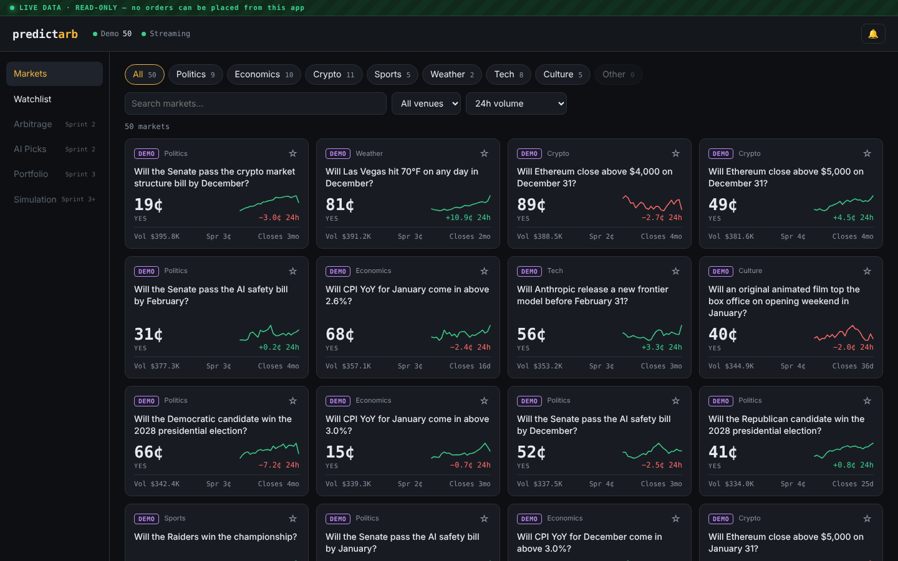
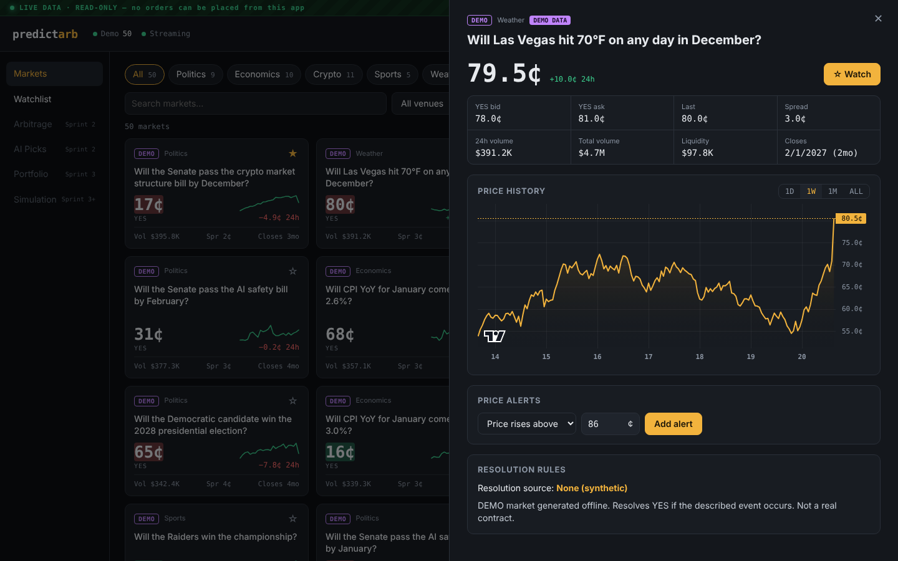
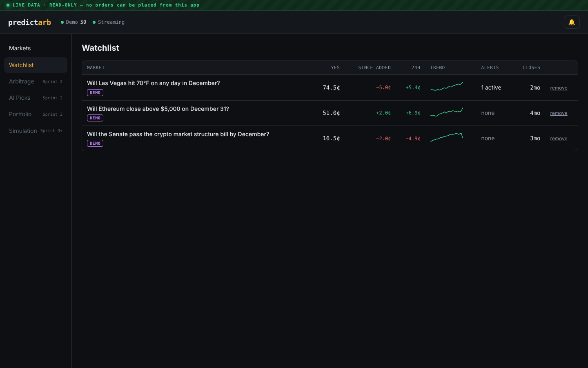

# predictarb

A self-hosted prediction-market terminal. It pulls live markets from **Kalshi** and **Polymarket** into one catalog, records price history, and serves a fast web UI with a market grid, charts, a watchlist and price alerts. Later sprints add the cross-venue arbitrage scanner, AI picks, paper trading and a synthetic simulation mode.

**Sprint 1 status: read-only foundation.** No API keys are needed and no orders can be placed: every venue call uses public market-data endpoints.



| Market detail | Watchlist |
| --- | --- |
|  |  |

## Quick start

```bash
gh repo clone JasonDoug/Arbitrage && cd Arbitrage && cp .env.example .env && docker compose up -d --build
```

Open <http://localhost:8080>. The catalog fills within a minute or two; history for the top 150 markets backfills in the background.

To try it with no network access (fake markets with random-walk prices), set `VENUES=demo` in `.env`.

| Task | One-liner |
| --- | --- |
| Logs | `docker compose logs -f ingest api` |
| Update after a pull | `git pull && docker compose up -d --build` |
| Stop | `docker compose down` |
| Wipe all data | `docker compose down -v` |

## What's in Sprint 1

| Area | Delivered |
| --- | --- |
| Venue connectors | Kalshi (events + series categories, quotes, hourly candlesticks); Polymarket global (Gamma catalog + quotes, CLOB price history). Rate limiting, retry with backoff on 429/5xx, per-venue health status. Polymarket US is a placeholder adapter until its REST paths are verified. |
| Unified catalog | One `market` table across venues: normalized YES prices (0–1), shared category taxonomy, rules text and hash, resolution source, close time. Markets a venue stops listing are marked `unlisted`. |
| Price history | `price_tick` table (a TimescaleDB hypertable when available). Ticks are written only when prices change, plus 30 days of hourly backfill for top markets, watched markets, and any market you open. |
| Event bus | Redis Streams: `quotes`, `notifications`, `backfill.requests`. |
| API | FastAPI: markets (filter, search, sort, paginate, sparklines), detail, history (1D/1W/1M/ALL), watchlist, alert rules, notifications, and a WebSocket live feed. |
| Web UI | Markets tab (category chips, venue filter, search, 6 sorts, live-updating cards with sparklines), detail drawer (stats, chart, rules, alerts), Watchlist, alert toasts and notification bell. A LIVE · READ-ONLY band on every screen. |
| Alerts | Price rises above / falls below (fires on the crossing, with cooldown), and "moves by X¢ within N minutes". |

## Sprint 2a: cross-venue matching and arbitrage

| Area | Delivered |
| --- | --- |
| Matcher | Every 30 min, pairs each Kalshi market with the Polymarket market most likely to resolve on the same fact: TF-IDF over title/outcome/event text, with synonyms for common outcome wording (Hold = no change, hike = increase, bps), numbers that must agree (thresholds, years), end-date distance and category. Pairs are **suggestions** until you confirm them. |
| Match review | Arbitrage → Match review: side-by-side markets, prices, end dates, and both rule sets. Confirm as identical or inverse, or reject. Rejected pairs aren't suggested again; a confirmed pair whose rules text later changes is flagged. |
| Arbitrage | For confirmed pairs, both directions: buy YES on one venue and NO on the other (same side on both for inverse pairs). Net edge = $1 − both asks − both taker fees, plus annualized return to the later end date. Quotes older than `ARB_MAX_QUOTE_AGE_S` are skipped. Top of book only: depth isn't checked yet. |
| Fees | Kalshi: 0.07 × P × (1 − P) per contract (rounded up per order). Polymarket: category rate × p × (1 − p), with rates configurable via `POLYMARKET_FEE_RATES`. |
| Episodes | The worker records how long each positive edge stays open (`arb_opportunity`), shown as "Open for". |
| Tracking | Watched and linked markets stay tracked even if they fall out of a venue's top-N cut. |

## Sprint 2b: news

| Area | Delivered |
| --- | --- |
| Feeds | 15 free RSS feeds (BBC, NPR, Guardian, Al Jazeera, Politico, NYT, CNBC, Federal Reserve, BLS, CoinDesk, ESPN), polled every 5 minutes. Override the list with `NEWS_FEEDS` (JSON name → URL). A failing feed is logged and skipped. |
| Dedupe | Same URL or same headline across feeds keeps the earliest copy. Items older than `NEWS_RETENTION_DAYS` (14) are pruned. |
| Matching | Headline + summary vs. each market's text: TF-IDF, same synonyms as the matcher, at least two shared distinctive terms (including threshold numbers like 120000). |
| UI | News sidebar (Watchlist / Markets / All; toggle with the News button), "Related news" in the market drawer, and a notification when a strong match hits a watched market. |

## Sprint 2c: AI Picks and AI match checks

| Area | Delivered |
| --- | --- |
| LLM client | Any OpenAI-compatible endpoint: OpenRouter (`openrouter/free` routes to a free model by default) and/or a local server (llama.cpp / llama-swap, Ollama, LM Studio, vLLM), tried in `LLM_ORDER`. Tolerates fenced or chatty JSON and `<think>` blocks; one retry on a bad reply. Every call is logged (`llm_call`) and capped by `AI_MAX_CALLS_PER_DAY`. |
| AI Picks | **AI Analyze** pre-scores liquid, contested markets with fresh quotes (volume, spread, timing, news), analyzes the top 8 with `AI_SAMPLES` samples each, and ranks them by Opportunity Score. The model only estimates a fair probability. Buy YES / Buy NO / Avoid comes from fixed rules: at least a 5¢ edge after the venue's fee and confidence ≥ 60 (10¢ for high-risk). Confidence drops when samples disagree. Each pick shows fair value, net edge, a confidence bar, risk, edge type, reasoning, key risks and catalysts. Results are cached for 15 minutes. |
| Per-market | "AI analysis" in the market drawer, with Analyze / Re-analyze. |
| Match checks | After each matcher run, the LLM reads both rule sets of up to `MATCH_LLM_PER_RUN` suggested pairs and labels them identical / inverse / different, listing material differences. Advisory only: you still confirm every pair. |
| Reproducibility | Each analysis stores the prices and news it saw, every sample, the model and the prompt version. |

**Setup:** add `OPENROUTER_API_KEY=...` to `.env`. For a model running on this machine, also set `LOCAL_LLM_URL=http://host.docker.internal:PORT/v1` and `LOCAL_LLM_MODEL`. Then run `docker compose up -d`.

## Sprint 3: paper trading and order-book depth

| Area | Delivered |
| --- | --- |
| Order books | Live books from Polymarket's CLOB and Kalshi, normalized to YES/NO ladders. If Kalshi's book endpoint needs auth, the best bid/ask sizes Kalshi reports on each market are used instead, and the UI says "top of book only". Shown in the market drawer. |
| Depth-aware arbitrage | For positive-edge pairs, both books are walked level by level to find the size with the most total dollar edge after fees: "Max size" and "$ edge" columns. |
| Paper trading | Accounts with fake cash ($10,000 default; create more, reset any). The market drawer has a ticket with buy/sell, YES/NO, market/limit and a live preview (fill price, fee, max loss, payout). Market orders walk the live book with a 10¢ fat-finger guard and pay the venue's taker fee. Limit orders fill what's marketable now and rest the remainder, which the worker fills fee-free when a later quote reaches the price (no queue position, so fills at the touch are optimistic). |
| Arbitrage execution | "Paper trade" on an arbitrage row buys both legs as one group, each capped 2¢ past the quote. Unfilled remainders are cancelled, and you're warned if the legs end up uneven. |
| Ledger | Cash, positions, average cost (fees included), realized and unrealized P&L are always derived from the fills table. Positions settle at $1/$0 when the venue reports a result (checked every 10 minutes). |
| Portfolio tab | Equity, P&L, cash and reserved cash, fees, win rate, max drawdown; equity curve (snapshots every 5 minutes) marked at mid or at exit bid; positions, open orders (cancel), and fill history. |

Every trade in the app is paper. Nothing here can place a real order.

## Architecture

```
Kalshi ─┐                                   ┌─> API (FastAPI) ──> Web (React, nginx)
        ├─> ingest worker ─> Postgres/Timescale
Polymarket┘        │                         │
                   └──────> Redis Streams ───┘   (quotes, notifications, backfill requests)
```

- `backend/predictarb/venues/`: one adapter per venue behind a shared interface (`fetch_markets`, `fetch_quotes`, `fetch_history`)
- `backend/predictarb/ingest/worker.py`: per-venue catalog and quote loops, backfill, alert evaluation
- `backend/predictarb/api/main.py`: REST + WebSocket
- `backend/predictarb/migrations/`: SQL schema, applied automatically on startup
- `web/`: Vite + React + TypeScript, charts by TradingView Lightweight Charts

### Venue notes

- **Kalshi:** prices are dollar strings (`"0.5600"`), so 24h dollar volume is estimated as contracts × price. Kalshi lists about 200k open markets, mostly untraded strike ladders, so only markets with 24h volume or open interest are tracked: the top `KALSHI_MAX_MARKETS` by 24h dollar volume. Quotes are then polled by ticker in batches rather than by scanning every market. Multivariate combo markets are excluded (`KALSHI_EXCLUDE_MVE`).
- **Polymarket (global):** used as a price signal only, since trading there is geoblocked for US users. Only order-book markets are ingested, the top `POLYMARKET_MAX_MARKETS` by 24h volume. Gamma returns at most 100 rows per page, and `prices-history` rejects long time spans, so history is fetched in 7-day windows that shrink automatically if the API rejects them.
- **Jurisdiction:** some Kalshi categories are restricted in Nevada while litigation continues. Sprint 1 never trades, so nothing is gated yet; the jurisdiction gate arrives with live trading.

## Configuration

All settings are environment variables; see [`.env.example`](.env.example) and [`backend/predictarb/config.py`](backend/predictarb/config.py).

## Development

```bash
cd backend && uv venv && uv pip install -e ".[dev]" && .venv/bin/pytest -q
```

Integration tests need Postgres and Redis on localhost (`DATABASE_URL`, `REDIS_URL`); they skip otherwise. Run the API and worker with `predictarb-api` and `predictarb-ingest`.

```bash
cd web && npm install && npm run dev   # proxies /api and /ws to localhost:8000
```

## Roadmap

See the design doc. Next up: **Sprint 2**, which covers the cross-venue market matcher, the arbitrage scanner, the news pipeline, and AI analysis / AI Picks via OpenRouter and local models.
